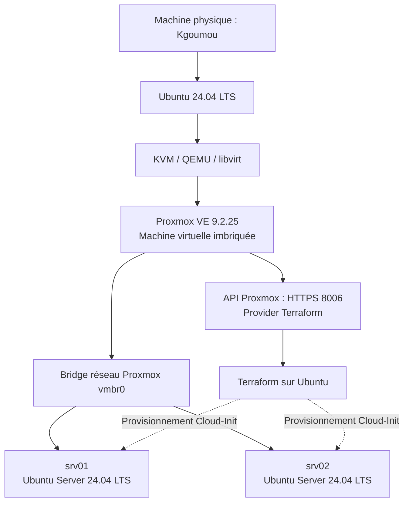

# Terraform Proxmox VE — Déploiement automatisé de machines virtuelles Ubuntu

<p align="center">
    <strong>Infrastructure as Code (IaC) avec Terraform, Proxmox VE et Cloud-Init</strong>
</p>

<p align="center">
  
  
  
  
  
</p>

## 1. Présentation du projet

Ce projet consiste à automatiser le déploiement et la gestion de machines virtuelles Ubuntu Server sur **Proxmox Virtual Environment (VE)** à l'aide de **Terraform**.

Il repose sur une architecture de virtualisation imbriquée (*Nested Virtualization*) :

- Un hôte Ubuntu Linux utilisant KVM/QEMU et libvirt.
- Une machine virtuelle Proxmox VE 9.2.25 exécutée dans KVM.
- Des machines virtuelles Ubuntu Server 24.04 LTS déployées directement sur Proxmox VE à l'aide de Terraform et Cloud-Init.

L'objectif principal est de mettre en œuvre une approche Infrastructure as Code (IaC) permettant de provisionner, configurer et gérer des machines virtuelles de manière automatisée, reproductible et contrôlée.

Le projet couvre également la sécurisation de l'accès à l'API Proxmox, la gestion des certificats TLS, la préparation du stockage, la configuration réseau, l'accès SSH et le versionnement du code avec Git.

## 2. Objectifs du projet

Les principaux objectifs sont :

- Préparer un environnement de virtualisation imbriquée avec KVM/QEMU et Proxmox VE.
- Configurer un accès sécurisé à l'API Proxmox.
- Mettre en place les certificats TLS et la relation de confiance.
- Auditer et préparer les ressources de stockage de Proxmox.
- Installer et configurer le provider Terraform pour Proxmox.
- Définir des paramètres réutilisables avec les variables Terraform.
- Automatiser le provisionnement des machines virtuelles avec Cloud-Init.
- Configurer les ressources CPU, mémoire, disque et réseau.
- Déployer dynamiquement plusieurs machines virtuelles Ubuntu Server.
- Configurer l'authentification SSH par clé publique et le réseau DHCP.
- Sécuriser les variables d'environnement et les fichiers sensibles.
- Versionner et publier le projet avec Git et GitHub.

## 3. Architecture de l'infrastructure

Le projet utilise une architecture de virtualisation imbriquée.

### 3.1 Schéma d'architecture



### 3.2 Composants de l'infrastructure

| Composant | Description |
|---|---|
| Hôte physique | Kgoumou |
| Système d'exploitation hôte | Ubuntu 24.04 LTS |
| Plateforme de virtualisation | KVM / QEMU |
| Gestionnaire de machines virtuelles | libvirt |
| Hyperviseur | Proxmox VE 9.2.25 |
| Nœud Proxmox | pve1 |
| Adresse IP de Proxmox | 192.168.122.32 |
| API Proxmox | HTTPS, port 8006 |
| Bridge réseau Proxmox | vmbr0 |
| Système des VM | Ubuntu Server 24.04 LTS |
| Automatisation de l'infrastructure | Terraform |
| Initialisation des VM | Cloud-Init |

### 3.3 Machines virtuelles déployées

Le déploiement initial comprend deux machines virtuelles Ubuntu Server.

| Ressource | srv01 | srv02 |
|---|---:|---:|
| VMID Proxmox | 100 | 101 |
| Système | Ubuntu Server 24.04 LTS | Ubuntu Server 24.04 LTS |
| vCPU | 1 | 1 |
| RAM | 1024 Mo | 1024 Mo |
| Disque | 15 Go | 15 Go |
| Réseau | DHCP | DHCP |
| Utilisateur Linux | kaman | kaman |

Adresses IP obtenues lors de la validation :

- srv01 : `192.168.122.149`
- srv02 : `192.168.122.110`

Ces adresses correspondent aux baux DHCP observés lors du déploiement. Elles ne sont pas déclarées comme adresses fixes dans Terraform.

## 4. Technologies et outils utilisés

| Technologie | Rôle |
|---|---|
| Ubuntu 24.04 LTS | Système d'exploitation hôte |
| KVM / QEMU | Virtualisation matérielle |
| libvirt | Gestion des machines virtuelles |
| Proxmox VE 9.2.25 | Plateforme de virtualisation |
| Terraform 1.17.1 | Infrastructure as Code |
| bpg/proxmox v0.120.0 | Provider Terraform pour Proxmox |
| Cloud-Init | Initialisation automatisée des VM |
| Ubuntu Cloud Image | Image de base du système |
| SSH | Administration distante sécurisée |
| Git | Gestion des versions |
| GitHub CLI | Gestion du dépôt GitHub |
| GitHub | Hébergement du code et de la documentation |

## 5. Organisation du projet

```text
terraform-proxmox/
│
├── docs/
│   ├── 01-preparation-env-installation-terraform.md
│   ├── 02-preparation-connexion-proxmox.md
│   ├── ...
│   └── 28-publication-projet-terraform-proxmox-github.md
│
├── images/                  # Exclu du suivi Git
│
├── .gitignore
├── .terraform.lock.hcl
├── provider.tf
├── variables.tf
├── versions.tf
├── vm.tf
│
└── README.md
```

Le répertoire `docs/` contient les 28 sections de documentation technique retraçant chronologiquement la réalisation du projet.

Le répertoire `images/` contient les images système conservées localement et exclues du versionnement Git.

Les fichiers d'état Terraform, les plans enregistrés et les identifiants API locaux sont également exclus du dépôt.

## 6. Configuration Terraform

Le projet utilise plusieurs fichiers Terraform afin de séparer les différentes responsabilités de configuration.

| Fichier | Fonction |
|---|---|
| `versions.tf` | Définition des versions de Terraform et du provider |
| `provider.tf` | Configuration du provider Proxmox |
| `variables.tf` | Déclaration des variables d'infrastructure |
| `vm.tf` | Définition des ressources de machines virtuelles |
| `.terraform.lock.hcl` | Verrouillage des versions des dépendances |

### 6.1 Provider Proxmox

Le projet utilise le provider `bpg/proxmox`.

```hcl
provider "proxmox" {}
```

Les informations d'authentification sont fournies à travers les variables d'environnement et ne sont pas inscrites directement dans le code Terraform.

### 6.2 Variables d'infrastructure

La configuration permet notamment de définir :

- Le nombre de machines virtuelles.
- Le préfixe de nommage.
- Le nombre de cœurs CPU.
- La quantité de mémoire.
- La capacité des disques.
- Le nom de l'utilisateur Linux.
- Le chemin de la clé publique SSH.
- Le bridge réseau Proxmox.

### 6.3 Provisionnement dynamique des VM

Terraform utilise la méta-argument `count` pour générer plusieurs machines virtuelles à partir d'une seule définition de ressource.

Cloud-Init assure la configuration initiale des comptes Linux, des clés SSH et du réseau DHCP.

## 7. Prérequis

Pour reproduire ce projet, les composants suivants sont nécessaires :

- Un hôte Ubuntu Linux disposant de KVM/QEMU et libvirt.
- Proxmox VE installé dans une machine virtuelle imbriquée.
- Une connectivité réseau entre Terraform et l'API Proxmox.
- Un utilisateur API Proxmox avec un rôle et un token dédiés.
- Un certificat TLS reconnu pour le point d'accès Proxmox.
- Un stockage Proxmox adapté aux disques des machines virtuelles.
- Une image Ubuntu Server 24.04 Cloud.
- Terraform CLI.
- Git et GitHub CLI (facultatif pour la publication).
- Une paire de clés SSH pour accéder aux machines virtuelles.

## 8. Déroulement du déploiement

La réalisation suit les principales étapes suivantes :

1. Préparation de l'environnement Ubuntu et Proxmox.
2. Configuration de l'API Proxmox et de la sécurité TLS.
3. Audit et préparation des ressources de stockage.
4. Téléchargement et préparation de l'image Ubuntu Cloud.
5. Initialisation du projet Terraform.
6. Configuration du provider Proxmox.
7. Déclaration des variables d'infrastructure.
8. Configuration de Cloud-Init.
9. Déclaration des ressources de machines virtuelles.
10. Génération et vérification du plan Terraform.
11. Déploiement des machines virtuelles.
12. Validation du DHCP, de la connectivité réseau, de SSH et de l'accès Internet.
13. Sécurisation des variables d'environnement.
14. Publication du projet sur GitHub.

## 9. Sécurité

La sécurité constitue un élément important de ce projet.

Les mesures suivantes ont été mises en place :

- Utilisation d'un utilisateur et d'un token API Proxmox dédiés.
- Contrôle des permissions avec les rôles Proxmox.
- Configuration d'un certificat TLS pour l'API Proxmox.
- Stockage local des identifiants API dans un fichier `.env`.
- Restriction des permissions du fichier `.env` avec `chmod 600`.
- Exclusion de `.env` du suivi Git.
- Exclusion des fichiers d'état et des plans Terraform.
- Exclusion des images Ubuntu Cloud du dépôt Git.
- Authentification SSH par clé publique pour les machines virtuelles.

**Important :** ne jamais publier les tokens API, les clés privées SSH, les fichiers d'état Terraform ou toute autre information sensible.

## 10. Documentation technique

Le projet est documenté à travers 28 sections chronologiques. Chaque document présente les manipulations réalisées, les commandes exécutées, les configurations appliquées et les résultats des vérifications.

### Phase 1 — Préparation de l'environnement et de Proxmox

| Section | Documentation |
|---|---|
| 01 | [Préparation de l'environnement et installation de Terraform](docs/01-preparation-env-installation-terraform.md) |
| 02 | [Préparation de la connexion à Proxmox](docs/02-preparation-connexion-proxmox.md) |
| 03 | [Création de l'utilisateur, du rôle et du token API Proxmox](docs/03-creation-utilisateur-role-et-token-api-proxmox.md) |
| 04 | [Préparation de l'identité réseau et du HTTPS](docs/04-preparation-identite-reseau-et-https.md) |
| 05 | [Configuration de l'autorité de certification](docs/05-configuration-autorite-certification-ca.md) |
| 06 | [Création du certificat TLS Proxmox](docs/06-creation-certificat-tls-proxmox.md) |
| 07 | [Installation du certificat TLS Proxmox](docs/07-installation-certificat-tls-proxmox.md) |
| 08 | [Configuration de la confiance TLS dans Chromium](docs/08-configuration-confiance-tls-chromium.md) |

### Phase 2 — Préparation du stockage et de l'image Ubuntu Cloud

| Section | Documentation |
|---|---|
| 09 | [Audit du stockage et des ressources Proxmox](docs/09-audit-stockage-et-ressources-proxmox.md) |
| 10 | [Audit du stockage KVM et préparation des disques Proxmox](docs/10-audit-stockage-kvm-et-preparation-dimen-pve.md) |
| 11 | [Extension du disque virtuel QCOW2 Proxmox](docs/11-extension-disque-virtuel-qcow2-proxmox.md) |
| 12 | [Extension du stockage LVM-thin Proxmox](docs/12-extension-stockage-lvm-thin-proxmox.md) |
| 13 | [Préparation de l'image Ubuntu Cloud](docs/13-preparation-image-ubuntu-cloud-proxmox.md) |

### Phase 3 — Configuration Terraform et définition des VM

| Section | Documentation |
|---|---|
| 14 | [Initialisation du projet Terraform et du provider Proxmox](docs/14-initialisation-projet-terraform-provider-proxmox.md) |
| 15 | [Configuration du provider Proxmox dans Terraform](docs/15-configuration-provider-proxmox-terraform.md) |
| 16 | [Déclaration des variables Terraform](docs/16-declaration-variables-terraform.md) |
| 17 | [Préparation de Cloud-Init avec Terraform](docs/17-preparation-cloud-init-terraform-proxmox.md) |
| 18 | [Définition de la ressource VM Proxmox](docs/18-definition-ressource-terraform-proxmox-vm.md) |
| 19 | [Configuration Cloud-Init : utilisateur, SSH et DHCP](docs/19-configuration-cloud-init-utilisateur-ssh-dhcp.md) |
| 20 | [Configuration matérielle : CPU, RAM, disque et contrôleur](docs/20-configuration-materielle-cpu-ram-disque-controleur.md) |
| 21 | [Configuration du bridge réseau vmbr0](docs/21-configuration-reseau-bridge-vmbr0.md) |
| 22 | [Génération dynamique des machines virtuelles avec Terraform](docs/22-generation-dynamique-machines-virtuelles-terraform.md) |

### Phase 4 — Déploiement, validation et sécurisation

| Section | Documentation |
|---|---|
| 23 | [Premier Terraform Plan et préparation de l'image Ubuntu Cloud](docs/23-premier-terraform-plan-preparation-image-ubuntu-cloud_init.md) |
| 24 | [Restauration des variables d'environnement API Proxmox](docs/24-restauration-variable-environnement-api-proxmox-terraform.md) |
| 25 | [Déploiement des machines virtuelles avec Terraform Apply](docs/25-deploiement-machines-virtuelles-terraform-apply.md) |
| 26 | [Vérification du DHCP, du réseau et de l'accès SSH](docs/26-verification-reseau-dhcp-et-acces-ssh-vm.md) |
| 27 | [Sécurisation des variables d'environnement et du fichier .env](docs/27-securisation-variables-environnement-fichier-env.md) |
| 28 | [Publication du projet Terraform-Proxmox sur GitHub](docs/28-publication-projet-terraform-proxmox-github.md) |

## 11. État d'avancement du projet

Le déploiement initial de l'infrastructure a été réalisé et validé.

- Deux machines virtuelles Ubuntu Server déployées avec succès.
- État Terraform synchronisé avec Proxmox.
- Connectivité DHCP validée.
- Authentification SSH par clé publique validée.
- Accès Internet validé.
- Sécurisation des variables d'environnement mise en place.
- Dépôt GitHub créé et première version de la configuration Terraform publiée.

Les documents techniques détaillent chronologiquement les manipulations et les résultats de validation.

## 12. Auteur

**Kaman Goumou**

Administrateur Réseaux & Systèmes | Cloud & Infrastructure IT

Certifié Cisco CCNA

GitHub : [@kaman2803](https://github.com/kaman2803)

---

<p align="center">
  <strong>Infrastructure as Code — Automatiser. Déployer. Valider. Documenter.</strong>
</p>
