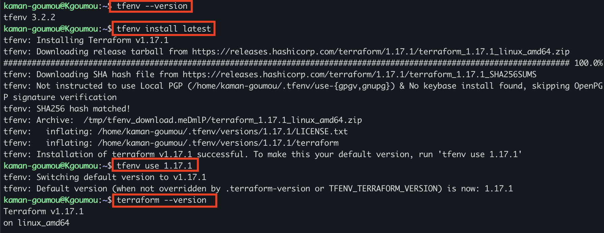

# Section 01 — Préparation de l'environnement et installation de Terraform

## 1. Objectif

Cette première section consiste à préparer la machine d'administration Kgoumou et à installer Terraform à l'aide de tfenv.

tfenv est un gestionnaire de versions qui permet d'installer, de sélectionner et de gérer plusieurs versions de Terraform sans dépendre d'une installation globale par APT.

## 2. Environnement utilisé

| Composant | Version / Configuration |
|---|---|
| Machine | Kgoumou |
| Utilisateur | kaman-goumou |
| Système d'exploitation | Ubuntu 24.04.5 LTS |
| Architecture | x86_64 (AMD64) |
| Git | 2.43.0 |
| cURL | 8.5.0 |
| tfenv | 3.2.2 |
| Terraform | 1.17.1 |

## 3. Vérification des prérequis

Avant de procéder à l'installation, nous avons vérifié la disponibilité des outils nécessaires sur Kgoumou.

### 3.1. Vérification de Git

Commande exécutée :

```bash
git --version
```

Résultat obtenu :

```text
git version 2.43.0
```

Git est utilisé pour récupérer le dépôt officiel de tfenv depuis GitHub.

### 3.2. Vérification de cURL

Commande exécutée :

```bash
curl --version
```

Résultat obtenu :

```text
curl 8.5.0 (x86_64-pc-linux-gnu) libcurl/8.5.0 OpenSSL/3.0.13 zlib/1.3 brotli/1.1.0 zstd/1.5.5 libidn2/2.3.7 libpsl/0.21.2 (+libidn2/2.3.7) libssh/0.10.6/openssl/zlib nghttp2/1.59.0 librtmp/2.3 OpenLDAP/2.6.10
Release-Date: 2023-12-06, security patched: 8.5.0-2ubuntu10.16
```

cURL est utilisé pour effectuer des transferts de données et télécharger des ressources depuis des serveurs distants.

**Bilan :** Git et cURL sont disponibles sur la machine. Les prérequis sont validés.

## 4. Installation et configuration de tfenv

### 4.1. Récupération du dépôt officiel

Nous avons cloné le dépôt officiel de tfenv dans le répertoire personnel de l'utilisateur.

Commande exécutée :

```bash
git clone https://github.com/tfutils/tfenv.git ~/.tfenv
```

Le clonage s'est terminé avec succès.

Répertoire d'installation :

```text
/home/kaman-goumou/.tfenv
```

### 4.2. Configuration de la variable PATH

Pour rendre la commande `tfenv` accessible depuis le terminal, nous avons ajouté son répertoire d'exécutables à la variable d'environnement PATH.

Commande exécutée :

```bash
echo 'export PATH="$HOME/.tfenv/bin:$PATH"' >> ~/.bashrc
```

Rechargement de la configuration :

```bash
source ~/.bashrc
```

### 4.3. Vérification de tfenv

Commande exécutée :

```bash
tfenv --version
```

Résultat obtenu :

```text
tfenv 3.2.2
```

La version 3.2.2 de tfenv est correctement installée.

## 5. Installation de Terraform

### 5.1. Installation de la dernière version stable

Nous avons utilisé tfenv pour installer la dernière version stable disponible au moment de l'installation.

Commande exécutée :

```bash
tfenv install latest
```

Version téléchargée et installée :

```text
Terraform v1.17.1
```

L'archive a été téléchargée depuis les serveurs officiels HashiCorp.

La vérification de l'empreinte SHA256 a réussi :

```text
tfenv: SHA256 hash matched!
tfenv: Installation of terraform v1.17.1 successful.
```

**Remarque :** la vérification de la signature OpenPGP a été ignorée, comme indiqué dans la sortie de tfenv. Seule la vérification SHA256 est confirmée ici.

### 5.2. Sélection de la version active

Après l'installation, nous avons sélectionné Terraform 1.17.1 comme version par défaut.

Commande exécutée :

```bash
tfenv use 1.17.1
```

Résultat obtenu :

```text
tfenv: Switching default version to v1.17.1
tfenv: Default version (when not overridden by .terraform-version or TFENV_TERRAFORM_VERSION) is now: 1.17.1
```

Terraform 1.17.1 est maintenant la version active gérée par tfenv.

## 6. Vérification finale de Terraform

Pour confirmer que Terraform est correctement installé et accessible depuis le terminal, nous avons exécuté :

```bash
terraform --version
```

Résultat obtenu :

```text
Terraform v1.17.1
on linux_amd64
```

La commande confirme que Terraform fonctionne sur l'architecture Linux AMD64.

## 7. Capture récapitulative de l'installation

La capture suivante regroupe les principales commandes exécutées et les résultats obtenus lors de l'installation et de la configuration de tfenv et Terraform.



## 8. Bilan de la section

À la fin de cette première section, l'environnement Terraform est opérationnel sur Kgoumou.

Les opérations suivantes ont été réalisées et validées :

- Vérification de Git et cURL.
- Récupération et installation de tfenv 3.2.2.
- Configuration de la variable PATH.
- Installation de Terraform 1.17.1.
- Sélection de Terraform 1.17.1 comme version active.
- Vérification du fonctionnement de Terraform.

**Conclusion :** la machine Kgoumou dispose désormais de l'environnement nécessaire pour commencer le projet d'automatisation du déploiement de ressources sur Proxmox VE 9.2 à l'aide de Terraform.