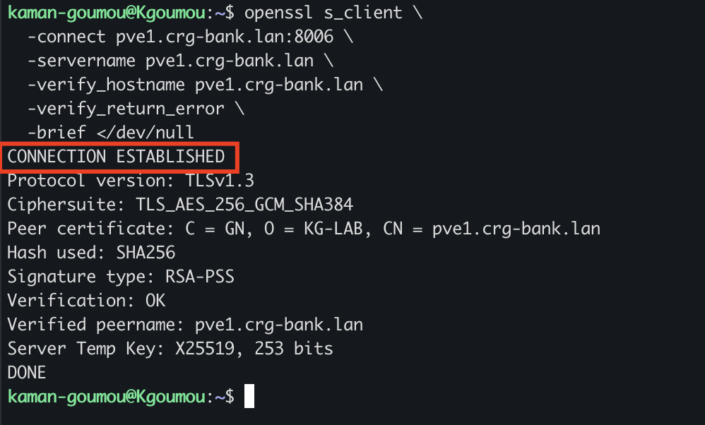

# 07 — Installation du certificat TLS personnalisé sur Proxmox VE

## 1. Objectifs

L'objectif de cette section est de déployer sur Proxmox VE un certificat TLS signé par notre autorité de certification interne **KG-LAB Root CA**.

Cette opération permet de :

- Remplacer l'identité HTTPS automatique de Proxmox par une identité personnalisée.
- Utiliser le nom DNS `pve1.crg-bank.lan`.
- Sécuriser les communications HTTPS sur le port TCP 8006.
- Établir une chaîne de confiance entre Proxmox et les postes d'administration.
- Préparer les connexions API nécessaires à Terraform sans désactiver la vérification TLS.

### Architecture de certification

| Élément | Valeur |
|---|---|
| Autorité de certification | KG-LAB Root CA |
| Serveur Proxmox | pve1 |
| FQDN | pve1.crg-bank.lan |
| Adresse IP | 192.168.122.32 |
| Port HTTPS | 8006 |
| Certificat serveur | pve1.crt.pem |
| Clé privée serveur | pve1.key.pem |
| Certificat CA | ca.crt.pem |
| Durée de validité du certificat serveur | 825 jours |

## 2. Vérification du certificat Proxmox existant

Avant toute modification, nous avons examiné les certificats actuellement utilisés par Proxmox.

### 2.1 Vérification des fichiers existants

Commandes exécutées sur Proxmox :

```bash
ls -l /etc/pve/local/pve-ssl.pem /etc/pve/local/pve-ssl.key
```

Résultat obtenu :

```text
-rw-r----- 1 root www-data 1704 Nov  3 10:32 /etc/pve/local/pve-ssl.key
-rw-r----- 1 root www-data 1789 Nov  3 10:32 /etc/pve/local/pve-ssl.pem
```

### 2.2 Identification du certificat automatique

Commande exécutée :

```bash
openssl x509 -in /etc/pve/local/pve-ssl.pem \
  -noout -subject -issuer -dates
```

Résultat obtenu :

```text
subject=OU=PVE Cluster Node, O=Proxmox Virtual Environment, CN=pve.crg-bank.lan
issuer=CN=Proxmox Virtual Environment, OU=8e7f8a0b-53d4-4daf-9791-9635ad7f0cf5, O=PVE Cluster Manager CA
notBefore=Nov  2 10:32:51 2026 GMT
notAfter=Nov  1 10:32:51 2028 GMT
```

**Interprétation :**

Proxmox utilisait encore son certificat généré automatiquement avec l'ancien nom `pve.crg-bank.lan`.

Nous allons conserver les certificats automatiques Proxmox et installer notre certificat personnalisé séparément.

## 3. Vérification de l'autorité de certification Proxmox

Commande exécutée :

```bash
pvenode cert info
```

Le résultat initial indiquait notamment :

```text
filename: pve-root-ca.pem
subject: /CN=Proxmox Virtual Environment/OU=8e7f8a0b-53d4-4daf-9791-9635ad7f0cf5/O=PVE Cluster Manager CA
```

**Interprétation :**

Proxmox dispose de sa propre autorité de certification interne. Nous conservons cette infrastructure et utilisons KG-LAB Root CA uniquement pour notre certificat TLS personnalisé.

## 4. Vérification des fichiers sur Kgoumou

Avant le transfert vers Proxmox, nous avons vérifié la présence du certificat et de sa clé privée sur le poste Ubuntu Kgoumou.

### 4.1 Vérification des fichiers

Commande exécutée :

```bash
ls -l ~/ca-proxmox/certs/pve1.crt.pem \
      ~/ca-proxmox/private/pve1.key.pem
```

Résultat obtenu :

```text
-rw-rw-r-- 1 kaman-goumou kaman-goumou 2004 Nov  4 01:08 /home/kaman-goumou/ca-proxmox/certs/pve1.crt.pem
-r-------- 1 kaman-goumou kaman-goumou 3272 Nov  4 01:05 /home/kaman-goumou/ca-proxmox/private/pve1.key.pem
```

La clé privée dispose des permissions `400`.

### 4.2 Vérification de la correspondance certificat / clé privée

Commandes exécutées :

```bash
openssl x509 -in ~/ca-proxmox/certs/pve1.crt.pem \
  -pubkey -noout | sha256sum

openssl pkey -in ~/ca-proxmox/private/pve1.key.pem \
  -pubout | sha256sum
```

Résultats obtenus :

```text
7fb0f96b7e400895c45caefddc9f72f4ade999768bc41813fe863673e65bcbdb  -
7fb0f96b7e400895c45caefddc9f72f4ade999768bc41813fe863673e65bcbdb  -
```

**Interprétation :**

Les deux empreintes SHA-256 sont identiques. Le certificat et sa clé privée correspondent bien.

## 5. Préparation du répertoire de réception sur Proxmox

Sur le serveur Proxmox, nous avons créé un répertoire temporaire destiné à recevoir les fichiers.

Commandes exécutées :

```bash
mkdir -p /root/terraform-certs
chmod 700 /root/terraform-certs
```

Vérification :

```bash
ls -ld /root/terraform-certs
```

Résultat obtenu :

```text
drwx------ 2 root root 4096 Nov  4 01:15 /root/terraform-certs
```

**Interprétation :**

Le répertoire est accessible uniquement à l'utilisateur root.

## 6. Transfert des certificats vers Proxmox

Nous avons utilisé SCP pour transférer les fichiers depuis Kgoumou vers le serveur Proxmox.

### 6.1 Transfert du certificat serveur

Commande exécutée sur Kgoumou :

```bash
scp ~/ca-proxmox/certs/pve1.crt.pem \
    root@192.168.122.32:/root/terraform-certs/
```

Résultat :

```text
pve1.crt.pem 100% 2004 9.3MB/s 00:00
```

### 6.2 Transfert de la clé privée serveur

Commande exécutée :

```bash
scp ~/ca-proxmox/private/pve1.key.pem \
    root@192.168.122.32:/root/terraform-certs/
```

Résultat :

```text
pve1.key.pem 100% 3272 5.0MB/s 00:00
```

La clé privée de l'autorité `ca.key.pem` n'a pas été transférée. Elle reste exclusivement sur Kgoumou.

### 6.3 Vérification des fichiers reçus

Sur Proxmox :

```bash
ls -l /root/terraform-certs/
```

Résultat obtenu :

```text
total 8
-rw-r--r-- 1 root root 2004 Nov  4 01:16 pve1.crt.pem
-r-------- 1 root root 3272 Nov  4 01:16 pve1.key.pem
```

### 6.4 Vérification de l'identité du certificat

Commande exécutée :

```bash
openssl x509 \
  -in /root/terraform-certs/pve1.crt.pem \
  -noout -subject -issuer -dates
```

Résultat obtenu :

```text
subject=C=GN, O=KG-LAB, CN=pve1.crg-bank.lan
issuer=C=GN, O=KG-LAB, CN=KG-LAB Root CA
notBefore=Nov  4 01:08:33 2026 GMT
notAfter=Feb  6 01:08:33 2029 GMT
```

## 7. Vérification de la chaîne de certification

Pour vérifier que le certificat serveur a bien été signé par notre autorité interne, nous avons également transféré le certificat public `ca.crt.pem`.

Sur Kgoumou :

```bash
scp ~/ca-proxmox/certs/ca.crt.pem \
    root@192.168.122.32:/root/terraform-certs/
```

Sur Proxmox :

```bash
openssl verify \
  -CAfile /root/terraform-certs/ca.crt.pem \
  /root/terraform-certs/pve1.crt.pem
```

Résultat obtenu :

```text
/root/terraform-certs/pve1.crt.pem: OK
```

**Interprétation :**

La chaîne de certification est valide. Le certificat serveur est reconnu comme ayant été signé par KG-LAB Root CA.

## 8. Installation du certificat personnalisé sur Proxmox

Nous avons utilisé la commande officielle `pvenode cert set` pour installer le certificat personnalisé.

Commande exécutée sur Proxmox :

```bash
pvenode cert set \
  /root/terraform-certs/pve1.crt.pem \
  /root/terraform-certs/pve1.key.pem \
  --restart 1
```

Cette commande permet :

- D'installer le certificat TLS personnalisé.
- D'installer sa clé privée correspondante.
- De redémarrer automatiquement le service `pveproxy`.

### 8.1 Résultat de l'installation

Proxmox a affiché :

```text
Restarting pveproxy
```

Puis les informations du certificat :

```text
filename: pveproxy-ssl.pem

subject: /C=GN/O=KG-LAB/CN=pve1.crg-bank.lan

issuer: /C=GN/O=KG-LAB/CN=KG-LAB Root CA

public-key-type: rsaEncryption
public-key-bits: 4096

san:
- pve1.crg-bank.lan
- 192.168.122.32
```

L'installation a été acceptée par Proxmox.

## 9. Diagnostic : ancien certificat encore présenté par HTTPS

Après l'installation, nous avons effectué un premier test TLS depuis Kgoumou.

Commande exécutée :

```bash
openssl s_client \
  -connect pve1.crg-bank.lan:8006 \
  -servername pve1.crg-bank.lan \
  -CAfile ~/ca-proxmox/certs/ca.crt.pem \
  -verify_hostname pve1.crg-bank.lan \
  -verify_return_error \
  -brief </dev/null
```

Le résultat indiquait :

```text
Peer certificate: C = GN, O = Proxmox Virtual Environment, CN = pve.crg-bank.lan

verify error:num=20:unable to get local issuer certificate
```

Le serveur présentait toujours l'ancien certificat automatique.

### 9.1 Vérification de la résolution DNS

Commande :

```bash
getent hosts pve1.crg-bank.lan
```

Résultat :

```text
192.168.122.32 pve1.crg-bank.lan pve1
```

La résolution DNS locale était correcte.

### 9.2 Vérification du certificat réellement présenté

Commande :

```bash
openssl s_client \
  -connect 192.168.122.32:8006 \
  -servername pve1.crg-bank.lan \
  </dev/null 2>/dev/null |
openssl x509 -noout -subject -issuer -fingerprint -sha256
```

Résultat :

```text
subject=OU = PVE Cluster Node, O = Proxmox Virtual Environment, CN = pve.crg-bank.lan

issuer=CN = Proxmox Virtual Environment, OU = 8e7f8a0b-53d4-4daf-9791-9635ad7f0cf5, O = PVE Cluster Manager CA

sha256 Fingerprint=CE:32:4E:9E:AD:FE:99:79:4B:14:6E:56:EE:4E:7C:D2:0F:BD:27:55:0D:1F:84:C5:2D:EB:71:CF:90:07:B4:6F
```

Le diagnostic a confirmé que le certificat automatique était encore présenté.

## 10. Identification de l'incohérence du nom du nœud Proxmox

Nous avons constaté que le certificat personnalisé était enregistré dans le répertoire :

```text
/etc/pve/nodes/pve1/
```

Cependant, le lien symbolique `/etc/pve/local` pointait encore vers :

```text
/etc/pve/nodes/pve
```

### 10.1 Vérification du lien symbolique

Commande :

```bash
ls -ld /etc/pve/local
readlink -f /etc/pve/local
```

Résultat :

```text
/etc/pve/local -> nodes/pve

/etc/pve/nodes/pve
```

### 10.2 Vérification de l'identité interne

Commande :

```bash
cat /etc/pve/.members
```

Résultat :

```json
{
"nodename": "pve",
"version": 0
}
```

En revanche, le hostname Linux était déjà `pve1`.

Commande :

```bash
hostnamectl
```

Résultat :

```text
Static hostname: pve1
```

**Diagnostic :**

Le hostname Linux et le nom interne du nœud Proxmox étaient différents.

Le système Linux utilisait `pve1`, alors que le système de fichiers de configuration Proxmox (pmxcfs) identifiait encore le nœud sous le nom `pve`.

## 11. Vérification de la possibilité de renommer le nœud

Avant toute modification, nous avons vérifié que le serveur était autonome et qu'il ne contenait aucune machine virtuelle ni aucun conteneur à préserver.

### 11.1 État du cluster

Commande :

```bash
pvecm status
```

Résultat :

```text
Error: Corosync config '/etc/pve/corosync.conf' does not exist - is this node part of a cluster?
```

Le serveur n'était pas membre d'un cluster Corosync.

### 11.2 Machines virtuelles

Commande :

```bash
qm list
```

Aucune machine virtuelle n'était présente.

### 11.3 Conteneurs

Commande :

```bash
pct list
```

Aucun conteneur n'était présent.

### 11.4 Vérification des fichiers d'identité

Fichier `/etc/hostname` :

```text
pve1
```

Fichier `/etc/hosts` :

```text
127.0.0.1 localhost.localdomain localhost
192.168.122.32 pve1.crg-bank.lan pve1

# The following lines are desirable for IPv6 capable hosts

::1     ip6-localhost ip6-loopback
fe00::0 ip6-localnet
ff00::0 ip6-mcastprefix
ff02::1 ip6-allnodes
ff02::2 ip6-allrouters
ff02::3 ip6-allhosts
```

La commande suivante affichait déjà `pve1` dans la liste des nœuds exposés par l'API :

```bash
pvesh get /nodes
```

## 12. Sauvegarde de la configuration avant renommage

Avant le redémarrage, nous avons créé une archive de sauvegarde des configurations.

Commande exécutée :

```bash
tar -czf /root/pve-config-before-rename-$(date +%F-%H%M%S).tar.gz \
  --exclude='etc/pve/local' \
  -C / \
  etc/pve etc/hostname etc/hosts
```

### 12.1 Vérification du contenu

Commande :

```bash
tar -tzf /root/pve-config-before-rename-*.tar.gz | head -30
```

L'archive contenait notamment :

- `etc/pve/.members`
- `etc/pve/storage.cfg`
- `etc/pve/user.cfg`
- `etc/pve/pve-root-ca.pem`
- `etc/pve/priv/`
- `etc/pve/datacenter.cfg`
- `etc/pve/ha/`

### 12.2 Sécurisation de l'archive

Commande :

```bash
chmod 600 /root/pve-config-before-rename-*.tar.gz
```

Résultat de vérification :

```text
-rw------- 1 root root 17K Nov 4 01:30 /root/pve-config-before-rename-2026-11-04-013025.tar.gz
```

**Important :** cette archive contient des informations sensibles, notamment des clés privées et la configuration des API tokens. Elle doit rester protégée.

## 13. Redémarrage et adoption du nouveau nom interne

Après vérification et sauvegarde, nous avons redémarré Proxmox.

Commande exécutée :

```bash
reboot
```

Après reconnexion SSH, nous avons vérifié l'identité interne.

### 13.1 Vérification du hostname

```bash
hostname
```

Résultat :

```text
pve1
```

### 13.2 Vérification du nom interne Proxmox

```bash
cat /etc/pve/.members
```

Résultat :

```json
{
"nodename": "pve1",
"version": 0
}
```

### 13.3 Vérification du lien symbolique

```bash
readlink -f /etc/pve/local
```

Résultat :

```text
/etc/pve/nodes/pve1
```

### 13.4 Vérification des répertoires de nœuds

```bash
ls -la /etc/pve/nodes/
```

Résultat :

```text
pve
pve1
```

Le nouveau nom interne est désormais adopté par Proxmox.

## 14. Vérification du certificat dans le nouveau répertoire actif

Après le redémarrage, nous avons vérifié le contenu de l'ancien répertoire `pve`.

Commande :

```bash
find /etc/pve/nodes/pve -maxdepth 3 -type f -ls
```

Les fichiers présents étaient :

```text
/etc/pve/nodes/pve/pve-ssl.key
/etc/pve/nodes/pve/lrm_status
/etc/pve/nodes/pve/pve-ssl.pem
/etc/pve/nodes/pve/ssh_known_hosts
```

L'ancien répertoire a été conservé. Aucune suppression manuelle n'a été effectuée.

### 14.1 Vérification des fichiers du nouveau nœud

Commande :

```bash
ls -l /etc/pve/local/pveproxy-ssl.pem \
      /etc/pve/local/pveproxy-ssl.key
```

Résultat :

```text
-rw-r----- 1 root www-data 3272 Nov  4 01:19 /etc/pve/local/pveproxy-ssl.key
-rw-r----- 1 root www-data 2004 Nov  4 01:19 /etc/pve/local/pveproxy-ssl.pem
```

### 14.2 Vérification de l'identité du certificat actif

Commande :

```bash
openssl x509 \
  -in /etc/pve/local/pveproxy-ssl.pem \
  -noout -subject -issuer -fingerprint -sha256
```

Résultat :

```text
subject=C=GN, O=KG-LAB, CN=pve1.crg-bank.lan
issuer=C=GN, O=KG-LAB, CN=KG-LAB Root CA

sha256 Fingerprint=C1:A5:CA:D8:DD:2E:C5:7B:3A:02:15:C9:31:13:25:00:F7:F7:1A:07:04:24:FE:89:E5:3D:BA:FB:05:F2:0E:B0
```

Le certificat personnalisé est désormais accessible au bon emplacement.

## 15. Validation TLS depuis Kgoumou

Nous avons relancé le test OpenSSL depuis Ubuntu.

Commande exécutée :

```bash
openssl s_client \
  -connect pve1.crg-bank.lan:8006 \
  -servername pve1.crg-bank.lan \
  -CAfile ~/ca-proxmox/certs/ca.crt.pem \
  -verify_hostname pve1.crg-bank.lan \
  -verify_return_error \
  -brief </dev/null
```

Résultat obtenu :

```text
CONNECTION ESTABLISHED
Protocol version: TLSv1.3
Ciphersuite: TLS_AES_256_GCM_SHA384
Peer certificate: C = GN, O = KG-LAB, CN = pve1.crg-bank.lan
Hash used: SHA256
Signature type: RSA-PSS
Verification: OK
Verified peername: pve1.crg-bank.lan
Server Temp Key: X25519, 253 bits
DONE
```

**Interprétation :**

Le serveur présente désormais le certificat personnalisé attendu.

La chaîne de certification est valide et le nom DNS correspond au SAN du certificat.

## 16. Installation de KG-LAB Root CA dans Ubuntu

Afin de ne plus devoir préciser manuellement le fichier CA lors des connexions TLS, nous avons ajouté notre autorité au magasin de confiance système d'Ubuntu.

### 16.1 Copie du certificat public

Commande exécutée sur Kgoumou :

```bash
sudo cp ~/ca-proxmox/certs/ca.crt.pem \
  /usr/local/share/ca-certificates/kg-lab-root-ca.crt
```

### 16.2 Actualisation du magasin de certificats

Commande exécutée :

```bash
sudo update-ca-certificates
```

Résultat obtenu :

```text
Updating certificates in /etc/ssl/certs...
rehash: warning: skipping ca-certificates.crt,it does not contain exactly one certificate or CRL
1 added, 0 removed; done.
Running hooks in /etc/ca-certificates/update.d...
done.
```

**Interprétation :**

- `1 added` : notre autorité KG-LAB Root CA a été ajoutée.
- `0 removed` : aucun certificat n'a été supprimé.
- L'avertissement sur `ca-certificates.crt` concerne le fichier bundle contenant plusieurs certificats et n'a pas empêché l'installation.

## 17. Validation finale HTTPS sans option de contournement

Nous avons réalisé une dernière vérification TLS sans utiliser `-k` et sans préciser `-CAfile`.

Commande exécutée :

```bash
openssl s_client \
  -connect pve1.crg-bank.lan:8006 \
  -servername pve1.crg-bank.lan \
  -verify_hostname pve1.crg-bank.lan \
  -verify_return_error \
  -brief </dev/null
```

Résultat obtenu :

```text
CONNECTION ESTABLISHED
Protocol version: TLSv1.3
Ciphersuite: TLS_AES_256_GCM_SHA384
Peer certificate: C = GN, O = KG-LAB, CN = pve1.crg-bank.lan
Hash used: SHA256
Signature type: RSA-PSS
Verification: OK
Verified peername: pve1.crg-bank.lan
Server Temp Key: X25519, 253 bits
DONE
```

### 17.1 Analyse de la validation

| Contrôle | Résultat |
|---|---|
| Connexion HTTPS | Réussie |
| Protocole TLS | TLS 1.3 |
| Suite de chiffrement | TLS_AES_256_GCM_SHA384 |
| Certificat présenté | pve1.crg-bank.lan |
| Autorité de certification | KG-LAB Root CA |
| Validation de la chaîne | OK |
| Validation du nom DNS | OK |
| Vérification sans `-k` | Réussie |
| Vérification sans `-CAfile` | Réussie |

### 17.2 Capture d'écran de validation

**Capture :** `screenshots/07-19-validation-tls-ubuntu.png`

La capture montre le résultat du test OpenSSL depuis Kgoumou, avec notamment :



Elle constitue la preuve visuelle de la validation TLS réussie.

---

## 18. Bilan de la section 07

Cette section a permis de déployer et de valider un certificat TLS personnalisé sur Proxmox VE.

Les opérations réalisées sont :

1. Vérification du certificat automatique Proxmox.
2. Vérification du certificat serveur et de sa clé privée.
3. Transfert sécurisé des fichiers vers Proxmox.
4. Vérification de la chaîne de certification.
5. Installation du certificat personnalisé avec `pvenode cert set`.
6. Diagnostic de l'incohérence entre le hostname Linux et le nom interne Proxmox.
7. Renommage effectif du nœud de `pve` vers `pve1`.
8. Vérification du répertoire actif et du certificat personnalisé.
9. Validation HTTPS avec OpenSSL.
10. Installation de KG-LAB Root CA dans le magasin de confiance Ubuntu.
11. Validation TLS finale sans désactivation de la vérification.

### État final de l'infrastructure

| Composant | État |
|---|---|
| Nœud Proxmox | pve1 |
| FQDN | pve1.crg-bank.lan |
| Adresse IP | 192.168.122.32 |
| Certificat personnalisé | Installé |
| Autorité KG-LAB Root CA | Validée |
| HTTPS | Opérationnel |
| TLS 1.3 | Validé |
| Confiance Ubuntu | Configurée |
| Vérification TLS sans `-k` | Réussie |

### Conclusion

L'infrastructure Proxmox VE dispose désormais d'une identité HTTPS cohérente avec le nom définitif du serveur.

L'autorité KG-LAB Root CA est reconnue par Ubuntu et les communications TLS vers l'API Proxmox peuvent être établies sans désactiver la vérification des certificats.

**Périmètre de cette section :** la configuration de confiance sur macOS n'a pas été réalisée. Elle sera documentée dans une section distincte.

La prochaine étape du projet consistera à préparer la connexion Terraform à l'API Proxmox avec le token dédié, en conservant la vérification TLS activée.