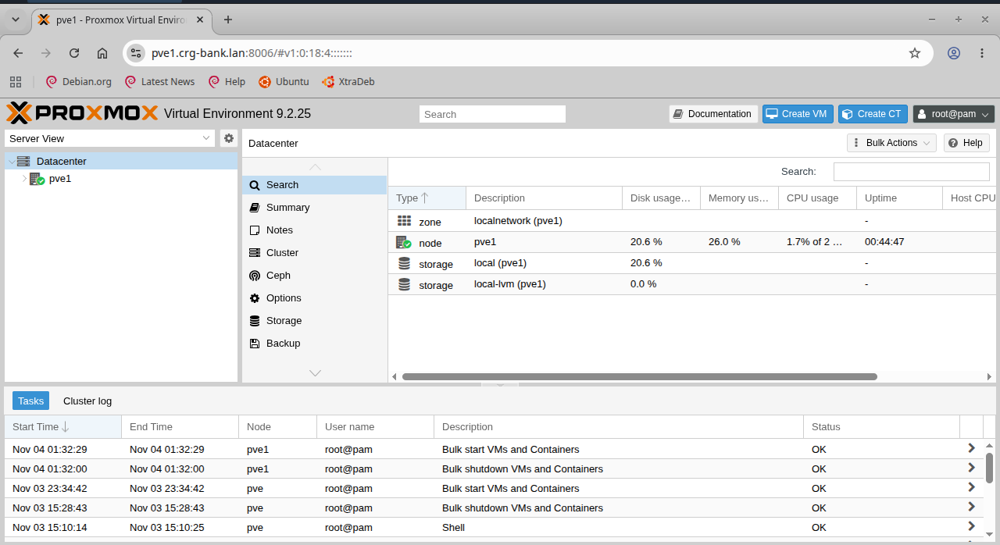

# 08 — Configuration de la confiance TLS dans Chromium sous Ubuntu

## 1. Objectif

Après l'installation du certificat TLS personnalisé sur Proxmox VE et l'ajout de l'autorité de certification KG-LAB Root CA dans le magasin de certificats système Ubuntu, le navigateur Chromium affichait encore une erreur :

`NET::ERR_CERT_AUTHORITY_INVALID`

Cette section décrit l'installation de l'outil de gestion des certificats NSS, l'importation de l'autorité de certification KG-LAB Root CA dans la base NSS de Chromium et la validation de l'accès HTTPS.

## 2. Installation de l'outil libnss3-tools

Pour gérer les certificats dans la base NSS de Chromium, nous utilisons l'utilitaire `certutil`, fourni par le paquet `libnss3-tools`.

**Commande d'installation :**

```bash
sudo apt update
sudo apt install libnss3-tools
```

Ce paquet fournit notamment :

- `certutil` : gestion des certificats et des attributs de confiance dans la base NSS.
- Les outils nécessaires à l'administration des bases de certificats NSS.

**Vérification de l'installation :**

```bash
certutil -H | head -10
```

L'affichage de l'aide de `certutil` confirme que l'utilitaire est disponible.

## 3. Vérification de la base de certificats NSS

Chromium utilise une base de certificats NSS pour gérer les autorités de certification auxquelles il fait confiance.

**Commande exécutée :**

```bash
ls -lh ~/.pki/nssdb/
```

**Résultat obtenu :**

```text
total 68K
-rw------- 1 kaman-goumou kaman-goumou 28K May 22 01:31 cert9.db
-rw------- 1 kaman-goumou kaman-goumou 36K May 22 01:31 key4.db
-rw------- 1 kaman-goumou kaman-goumou 453 May 22 01:31 pkcs11.txt
```

La présence des fichiers `cert9.db` et `key4.db` confirme l'existence d'une base NSS au format SQL.

## 4. Vérification des certificats déjà enregistrés

**Commande exécutée :**

```bash
certutil -L -d sql:$HOME/.pki/nssdb
```

**Résultat obtenu avant l'importation :**

```text
Certificate Nickname                                         Trust Attributes
                                                             SSL,S/MIME,JAR/XPI
```

La liste ne contenait aucun certificat. L'autorité de certification KG-LAB Root CA devait donc être ajoutée à cette base.

## 5. Importation de l'autorité de certification KG-LAB Root CA

**Commande utilisée :**

```bash
certutil -A \
  -d sql:$HOME/.pki/nssdb \
  -n "KG-LAB Root CA" \
  -t "C,," \
  -i ~/ca-proxmox/certs/ca.crt.pem
```

### Explication des paramètres

- `-A` : ajoute un certificat dans la base NSS.
- `-d` : indique le répertoire de la base de certificats.
- `sql:$HOME/.pki/nssdb` : désigne la base NSS au format SQL.
- `-n` : définit le nom attribué au certificat.
- `-t "C,,"` : définit les attributs de confiance. Le premier champ `C` indique que cette autorité est approuvée pour délivrer des certificats de serveurs SSL/TLS.
- `-i` : indique le chemin du certificat à importer.

Le certificat importé est le certificat public de l'autorité KG-LAB Root CA, et non sa clé privée.

## 6. Vérification de l'importation

**Commande exécutée :**

```bash
certutil -L -d sql:$HOME/.pki/nssdb
```

**Résultat obtenu :**

```text
Certificate Nickname                                         Trust Attributes
                                                             SSL,S/MIME,JAR/XPI

KG-LAB Root CA                                               C,,
```

Le résultat confirme que le certificat KG-LAB Root CA est enregistré dans la base NSS avec l'attribut de confiance `C,,`.

## 7. Redémarrage et test du navigateur Chromium

Après l'importation, Chromium a été complètement fermé puis relancé afin de prendre en compte la nouvelle autorité de certification.

L'interface Web de Proxmox VE a ensuite été ouverte à l'adresse :

```text
https://192.168.122.32:8006
```

### Résultat de la validation



- L'interface Web de Proxmox VE chargée correctement.
- L'indication **Connection is secure** dans les informations de sécurité du navigateur.
- L'absence de l'avertissement `NET::ERR_CERT_AUTHORITY_INVALID`.

Point important : cette capture est particulièrement intéressante, car elle valide l'accès avec le FQDN inscrit dans le SAN du certificat, et pas uniquement avec l'adresse IP.

## 8. Conclusion

La configuration de la confiance TLS dans Chromium sous Ubuntu est terminée.

L'autorité de certification interne KG-LAB Root CA est maintenant reconnue par :

- Le magasin de certificats système Ubuntu.
- La base NSS utilisée par Chromium.

L'accès à l'interface Web de Proxmox VE est désormais établi avec une connexion HTTPS reconnue comme sécurisée par le navigateur.

**Remarque :** la configuration de la confiance TLS sur macOS sera traitée dans une section distincte.

## 9. Capture d'écran de validation

Fichier à intégrer dans le dépôt du projet :

```text
screenshots/08-validation-confiance-tls-chromium.png
```

Cette capture constitue la preuve visuelle de la validation de la connexion HTTPS dans Chromium.
