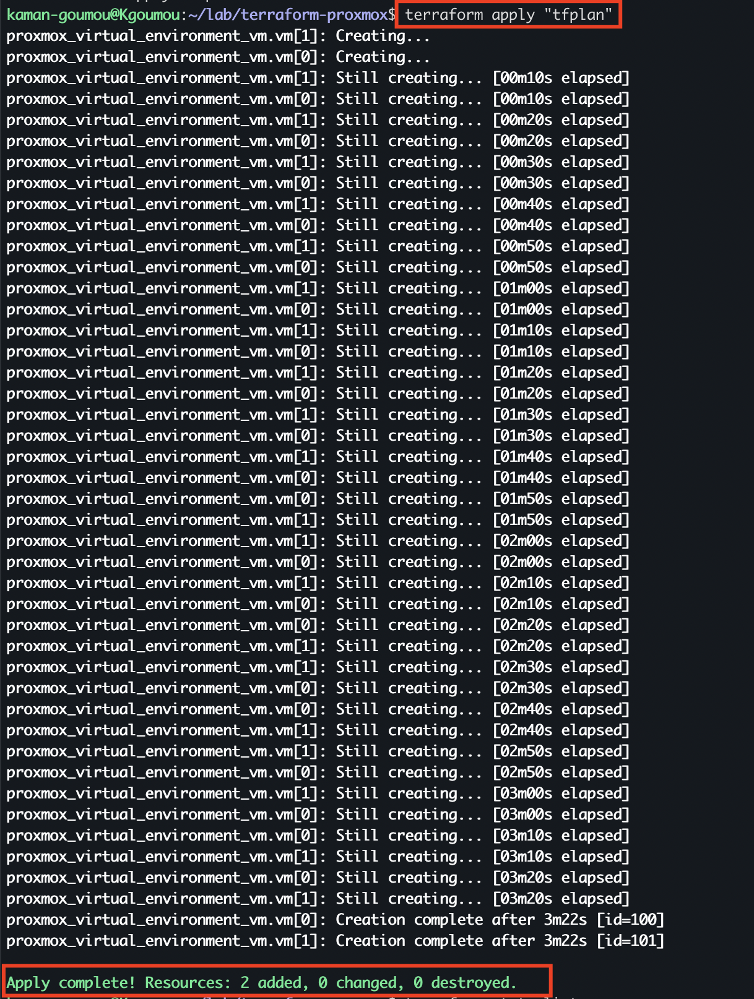
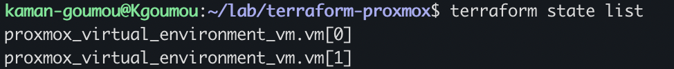
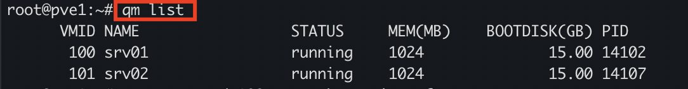

# Section 25 – Déploiement des machines virtuelles avec Terraform (terraform apply)

## 1. Objectif

Après avoir validé le premier plan Terraform dans la section 24, nous passons à la création effective des machines virtuelles sur Proxmox VE.

L'objectif est de déployer automatiquement deux machines virtuelles Ubuntu Server 24.04 LTS à partir de l'image Cloud-Init préalablement importée dans le stockage Proxmox.

Les deux machines prévues sont :

- `srv01`
- `srv02`

Cette opération permet de mettre en pratique l'Infrastructure as Code (IaC) avec Terraform et le provider `bpg/proxmox`.

## 2. Vérification de l'environnement

Avant le déploiement, nous avons vérifié la présence des deux variables d'environnement nécessaires à la connexion avec l'API Proxmox.

**Commande exécutée :**

```bash
if [ -n "$PROXMOX_VE_ENDPOINT" ] && [ -n "$PROXMOX_VE_API_TOKEN" ]; then echo "Variables API présentes"; else echo "Variables API absentes"; fi
```

**Résultat obtenu :**

```text
Variables API présentes
```

Les deux variables sont disponibles dans le terminal actuel de Kgoumou.

## 3. Génération et sauvegarde du plan Terraform

### 3.1. Création du plan

Avant d'appliquer les modifications, nous avons généré un plan Terraform sauvegardé dans un fichier nommé `tfplan`.

**Commande exécutée :**

```bash
terraform plan -out=tfplan
```

Cette commande permet de calculer les opérations prévues et de sauvegarder le plan afin de pouvoir appliquer exactement ces opérations ultérieurement.

### 3.2. Analyse du plan

Terraform a identifié deux nouvelles ressources à créer :

- `proxmox_virtual_environment_vm.vm[0]` : srv01
- `proxmox_virtual_environment_vm.vm[1]` : srv02

Les caractéristiques prévues pour chaque machine sont :

| Paramètre | Configuration |
|---|---|
| Nœud Proxmox | pve1 |
| Système | Ubuntu Server 24.04 |
| CPU | 1 vCPU |
| RAM | 1024 Mio |
| Disque | 15 Gio |
| Stockage | local-lvm |
| Contrôleur disque | virtio-scsi-pci |
| Réseau | vmbr0 |
| Modèle réseau | VirtIO |
| Adressage IPv4 | DHCP |
| Utilisateur Cloud-Init | kaman |

L'image source utilisée est :

```text
local:import/ubuntu-24.04-server-cloudimg-amd64.qcow2
```

### 3.3. Résultat du plan

Terraform a affiché :

```text
Plan: 2 to add, 0 to change, 0 to destroy.

Saved the plan to: tfplan

To perform exactly these actions, run the following command to apply:
    terraform apply "tfplan"
```

Le plan confirme que deux ressources seront créées, sans modification ni suppression de ressources existantes.

Le fichier `tfplan` contient le plan sauvegardé.

## 4. Application du plan Terraform

### 4.1. Lancement du déploiement

Après vérification du plan, nous avons lancé la création des machines virtuelles.

**Commande exécutée :**

```bash
terraform apply "tfplan"
```

Cette commande applique le plan sauvegardé et demande à Terraform de communiquer avec Proxmox VE pour créer les deux machines.

### 4.2. Déroulement de la création

Terraform a lancé les deux opérations de création simultanément.

**Début de l'exécution :**

```text
proxmox_virtual_environment_vm.vm[1]: Creating...
proxmox_virtual_environment_vm.vm[0]: Creating...
```

Pendant l'opération, Terraform a régulièrement affiché l'état d'avancement :

```text
proxmox_virtual_environment_vm.vm[1]: Still creating... [00m10s elapsed]
proxmox_virtual_environment_vm.vm[0]: Still creating... [00m10s elapsed]
```

Les messages `Still creating...` indiquent que les ressources sont toujours en cours de création.

Le processus s'est poursuivi jusqu'à la finalisation des deux opérations.

### 4.3. Résultat final du déploiement

**Résultat réellement obtenu :**

```text
proxmox_virtual_environment_vm.vm[0]: Creation complete after 3m22s [id=100]
proxmox_virtual_environment_vm.vm[1]: Creation complete after 3m22s [id=101]

Apply complete! Resources: 2 added, 0 changed, 0 destroyed.
```

Les deux machines virtuelles ont été créées avec succès.

| Machine virtuelle | VMID | Temps de création |
|---|---:|---:|
| srv01 | 100 | 3 min 22 s |
| srv02 | 101 | 3 min 22 s |

Le message `Apply complete!` confirme la réussite de l'application du plan.

## 5. Vérification de l'état Terraform

Après le déploiement, nous avons vérifié que les deux ressources étaient bien enregistrées dans l'état Terraform.

**Commande exécutée :**

```bash
terraform state list
```

**Résultat obtenu :**

```text
proxmox_virtual_environment_vm.vm[0]
proxmox_virtual_environment_vm.vm[1]
```

Cette commande affiche les ressources actuellement suivies par Terraform.

Les deux ressources sont présentes dans l'état Terraform :

- `vm[0]` correspond à `srv01`.
- `vm[1]` correspond à `srv02`.

Cela permet de confirmer que Terraform conserve le suivi des deux machines virtuelles déployées.

## 6. Vérification des machines virtuelles sur Proxmox VE

### 6.1. Inventaire des VM

Après la vérification côté Terraform, nous sommes passés sur le nœud Proxmox `pve1` afin de contrôler directement la présence des machines virtuelles.

**Commande exécutée sur PVE1 :**

```bash
qm list
```

**Résultat obtenu :**

```text
root@pve1:~# qm list
      VMID NAME                 STATUS     MEM(MB)    BOOTDISK(GB) PID
       100 srv01                running    1024              15.00 14102
       101 srv02                running    1024              15.00 14107
root@pve1:~#
```

### 6.2. Analyse du résultat

La commande `qm list` affiche les machines virtuelles présentes sur le nœud Proxmox.

Les informations obtenues confirment :

| Paramètre | srv01 | srv02 |
|---|---:|---:|
| VMID | 100 | 101 |
| Nom | srv01 | srv02 |
| État | running | running |
| Mémoire | 1024 Mio | 1024 Mio |
| Disque de démarrage | 15 Gio | 15 Gio |
| PID | 14102 | 14107 |

Les deux machines sont présentes sur `pve1` et leur état est `running`.

La vérification confirme également que les ressources matérielles prévues dans le plan Terraform correspondent aux valeurs affichées par Proxmox.

## 7. Vérification de QEMU Guest Agent

Nous avons ensuite tenté d'interroger les interfaces réseau de la première machine virtuelle depuis Proxmox.

**Commande exécutée sur PVE1 :**

```bash
qm guest cmd 100 network-get-interfaces
```

**Résultat obtenu :**

```text
QEMU guest agent is not running
```

Cette réponse indique que QEMU Guest Agent n'est pas actif sur `srv01`.

Cette fonctionnalité n'avait pas été ajoutée à notre configuration Terraform initiale. Nous ne poursuivons donc pas son installation dans cette section.

La vérification des adresses IP par cette méthode reste à effectuer ultérieurement.

## 8. Bilan de la section 25

| Vérification | Résultat |
|---|---|
| Variables API présentes | Validé |
| Génération du plan Terraform | Réussie |
| Sauvegarde du plan `tfplan` | Réussie |
| Application du plan | Réussie |
| Création de srv01 | Réussie – VMID 100 |
| Création de srv02 | Réussie – VMID 101 |
| Enregistrement dans Terraform State | Validé |
| Présence des VM sur PVE1 | Validée |
| État de srv01 | Running |
| État de srv02 | Running |
| QEMU Guest Agent | Non actif |

### Résultat final

```text
Apply complete! Resources: 2 added, 0 changed, 0 destroyed.
```

<text color="success" weight="semibold">SECTION 25 : DÉPLOIEMENT VALIDÉ</text>

Le déploiement des deux machines virtuelles Ubuntu Server 24.04 LTS avec Terraform est réussi.

Les machines `srv01` et `srv02` ont été créées sur le nœud Proxmox `pve1`, démarrées et enregistrées dans l'état Terraform.

La vérification de leur présence directement sur Proxmox confirme les VMID 100 et 101 ainsi que leurs ressources matérielles.

L'interrogation des interfaces réseau avec QEMU Guest Agent reste en attente, car cet agent n'est pas actif dans la configuration actuelle.

## 9. Captures d'écran

Les captures suivantes illustrent les opérations réellement effectuées.

### Capture 1 – Application du plan Terraform

Commande `terraform apply "tfplan"`, progression de la création des deux machines et résultat final `Apply complete!`.



### Capture 2 – Vérification de l'état Terraform

Commande `terraform state list` et affichage des deux ressources enregistrées.



### Capture 3 – Vérification des machines virtuelles sur PVE1

Commande `qm list` et affichage des deux VM en état `running`.



## 10. Étape suivante

La section 26 portera sur la vérification de la configuration réseau et de l'accès aux machines virtuelles.

Les objectifs seront notamment :

1. Vérifier l'attribution des adresses IP par DHCP.
2. Identifier les adresses IPv4 de `srv01` et `srv02`.
3. Vérifier l'accès SSH avec l'utilisateur `kaman`.
4. Contrôler la connectivité réseau des machines virtuelles.

**Nom du prochain fichier :**

`26-verification-reseau-dhcp-et-acces-ssh-vm.md`