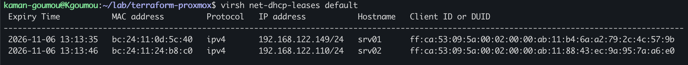
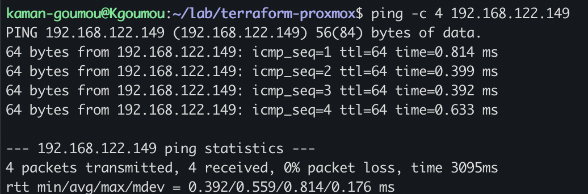
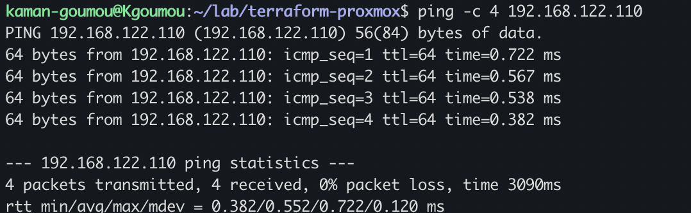
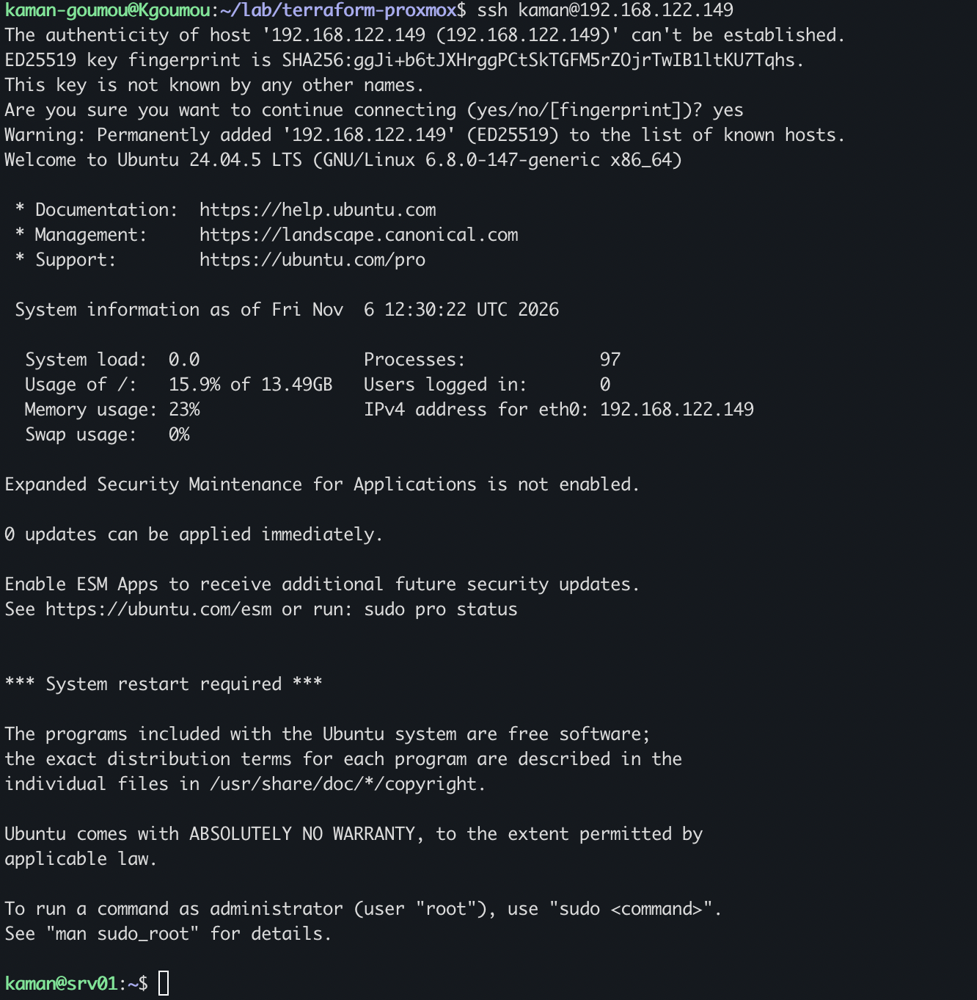
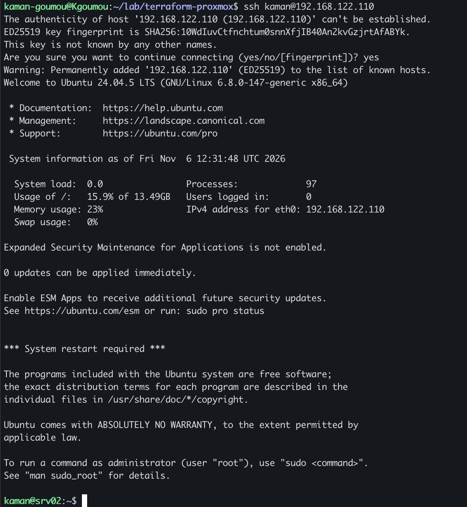
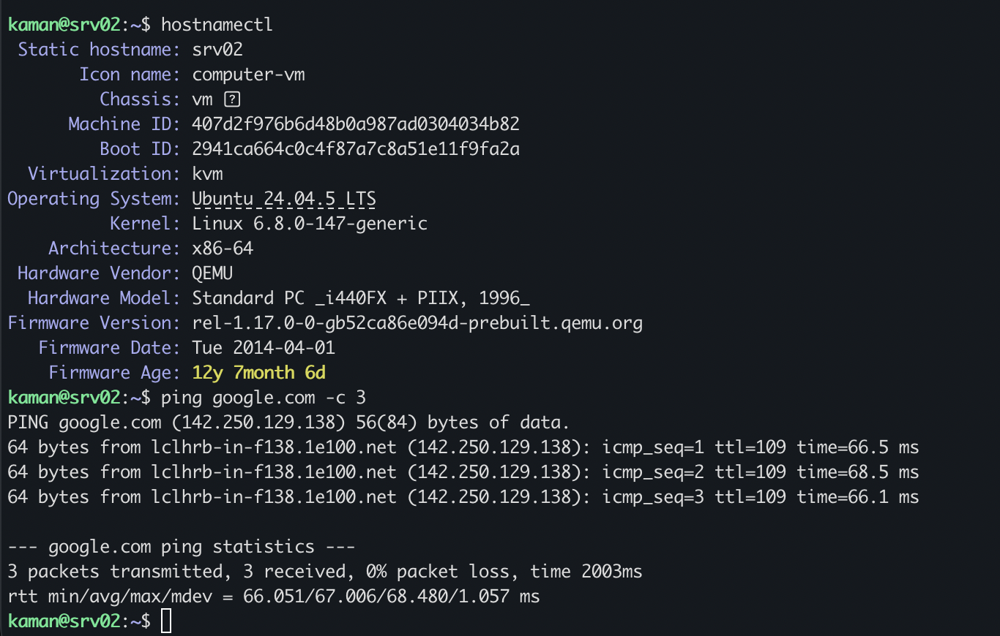
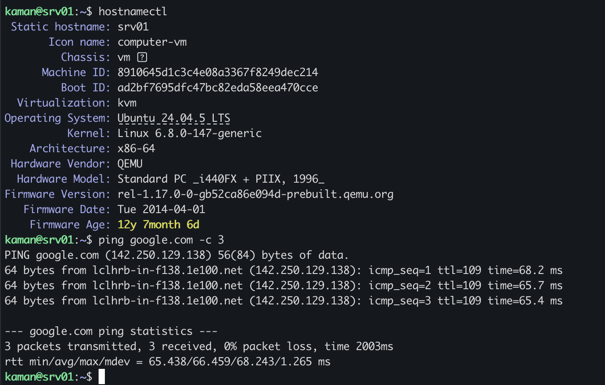

# Section 26 – Vérification du réseau DHCP et de l'accès SSH aux machines virtuelles

## 1. Objectif

Après le déploiement réussi des machines virtuelles `srv01` et `srv02` avec Terraform, cette section consiste à vérifier leur fonctionnement réseau et leur accessibilité depuis la machine hôte Kgoumou.

Les vérifications portent sur :

- L'attribution automatique des adresses IPv4 par DHCP.
- La connectivité réseau entre Kgoumou et les deux VM.
- L'accès distant SSH avec authentification par clé publique.
- La configuration des noms d'hôtes.
- La version du système d'exploitation et du noyau Linux.
- La résolution DNS et l'accès à Internet.

Les tests sont réalisés sur les deux machines Ubuntu Server 24.04.5 LTS.

## 2. Environnement et adressage réseau

Les deux machines virtuelles sont connectées au bridge `vmbr0` et utilisent le réseau libvirt `default` pour leur connectivité.

Les adresses IPv4 sont attribuées automatiquement par DHCP.

| Paramètre | srv01 | srv02 |
|---|---|---|
| VMID | 100 | 101 |
| Nom d'hôte | srv01 | srv02 |
| Adresse IPv4 | 192.168.122.149 | 192.168.122.110 |
| Masque | /24 | /24 |
| Adresse MAC | bc:24:11:0d:5c:40 | bc:24:11:24:b8:c0 |
| Utilisateur | kaman | kaman |
| Système | Ubuntu 24.04.5 LTS | Ubuntu 24.04.5 LTS |

## 3. Vérification de l'attribution DHCP

### 3.1. Consultation des baux DHCP

Depuis la machine hôte Kgoumou, nous avons consulté les baux DHCP du réseau libvirt `default`.

**Commande exécutée :**

```bash
virsh net-dhcp-leases default
```

**Résultat obtenu :**

```text
Expiry Time           MAC address         Protocol   IP address           Hostname   Client ID or DUID
------------------------------------------------------------------------------------------------------------------------------------------------
2026-11-06 13:13:35   bc:24:11:0d:5c:40   ipv4       192.168.122.149/24   srv01      ff:ca:53:09:5a:00:02:00:00:ab:11:b4:6a:a2:79:2c:4c:57:9b
2026-11-06 13:13:46   bc:24:11:24:b8:c0   ipv4       192.168.122.110/24   srv02      ff:ca:53:09:5a:00:02:00:00:ab:11:88:43:ec:9a:95:7a:a6:e0
```

### 3.2. Analyse du résultat

La commande affiche les baux DHCP attribués aux deux machines virtuelles.

Les informations obtenues permettent d'identifier :

- L'adresse MAC de chaque interface réseau.
- Le protocole IPv4 utilisé.
- L'adresse IP attribuée.
- Le nom d'hôte communiqué par chaque machine.
- La date d'expiration du bail DHCP.

Les résultats confirment que les deux machines ont obtenu automatiquement leurs adresses IPv4.

**Capture 1 – Consultation des baux DHCP**



## 4. Vérification de la connectivité réseau depuis Kgoumou

Après avoir identifié les adresses IP, nous avons effectué des tests ICMP depuis la machine hôte afin de vérifier que les deux VM sont joignables.

### 4.1. Test de connectivité vers srv01

**Commande exécutée :**

```bash
ping -c 4 192.168.122.149
```

**Résultat obtenu :**

```text
PING 192.168.122.149 (192.168.122.149) 56(84) bytes of data.
64 bytes from 192.168.122.149: icmp_seq=1 ttl=64 time=0.814 ms
64 bytes from 192.168.122.149: icmp_seq=2 ttl=64 time=0.399 ms
64 bytes from 192.168.122.149: icmp_seq=3 ttl=64 time=0.392 ms
64 bytes from 192.168.122.149: icmp_seq=4 ttl=64 time=0.633 ms

--- 192.168.122.149 ping statistics ---
4 packets transmitted, 4 received, 0% packet loss, time 3095ms
rtt min/avg/max/mdev = 0.392/0.559/0.814/0.176 ms
```

**Analyse :**

- 4 paquets envoyés.
- 4 paquets reçus.
- 0 % de perte.
- Temps moyen : 0,559 ms.

La machine `srv01` répond correctement aux requêtes ICMP provenant de Kgoumou.

**Capture 2 – Test ICMP vers srv01**



### 4.2. Test de connectivité vers srv02

**Commande exécutée :**

```bash
ping -c 4 192.168.122.110
```

**Résultat obtenu :**

```text
PING 192.168.122.110 (192.168.122.110) 56(84) bytes of data.
64 bytes from 192.168.122.110: icmp_seq=1 ttl=64 time=0.722 ms
64 bytes from 192.168.122.110: icmp_seq=2 ttl=64 time=0.567 ms
64 bytes from 192.168.122.110: icmp_seq=3 ttl=64 time=0.538 ms
64 bytes from 192.168.122.110: icmp_seq=4 ttl=64 time=0.382 ms

--- 192.168.122.110 ping statistics ---
4 packets transmitted, 4 received, 0% packet loss, time 3090ms
rtt min/avg/max/mdev = 0.382/0.552/0.722/0.120 ms
```

**Analyse :**

- 4 paquets envoyés.
- 4 paquets reçus.
- 0 % de perte.
- Temps moyen : 0,552 ms.

La machine `srv02` est également joignable depuis Kgoumou.

**Capture 3 – Test ICMP vers srv02**



## 5. Vérification de l'accès distant SSH

Nous allons maintenant vérifier l'accès distant aux machines virtuelles avec le protocole SSH.

L'authentification utilise la clé publique configurée précédemment dans Terraform avec Cloud-Init.

L'utilisateur Linux créé sur les deux VM est `kaman`.

### 5.1. Connexion SSH à srv01

**Commande exécutée depuis Kgoumou :**

```bash
ssh kaman@192.168.122.149
```

Lors de la première connexion, SSH a affiché une demande de confirmation de l'empreinte de la clé du serveur.

**Résultat obtenu :**

```text
The authenticity of host '192.168.122.149 (192.168.122.149)' can't be established.
ED25519 key fingerprint is SHA256:ggJi+b6tJXHrggPCtSkTGFM5rZOjrTwIB1ltKU7Tqhs.
This key is not known by any other names.
Are you sure you want to continue connecting (yes/no/[fingerprint])? yes
Warning: Permanently added '192.168.122.149' (ED25519) to the list of known hosts.
Welcome to Ubuntu 24.04.5 LTS (GNU/Linux 6.8.0-147-generic x86_64)
```

Après confirmation avec `yes`, la connexion SSH a été établie.

Le terminal affiche :

```text
kaman@srv01:~$
```

**Analyse :**

- Le serveur SSH de `srv01` accepte la connexion.
- L'utilisateur `kaman` existe.
- L'authentification par clé publique fonctionne.
- La machine présente correctement son nom d'hôte.
- La clé d'hôte SSH a été ajoutée au fichier `known_hosts` de Kgoumou.

Le message `System restart required` apparaît également dans le message d'accueil. Il indique qu'un redémarrage est nécessaire pour appliquer certains changements système.

**Capture 4 – Connexion SSH à srv01**



### 5.2. Connexion SSH à srv02

**Commande exécutée depuis Kgoumou :**

```bash
ssh kaman@192.168.122.110
```

Comme pour la première machine, SSH a demandé de confirmer l'empreinte de la clé du serveur.

Après confirmation avec `yes`, la connexion a été établie.

**Résultat obtenu :**

```text
Welcome to Ubuntu 24.04.5 LTS (GNU/Linux 6.8.0-147-generic x86_64)
```

Le terminal affiche :

```text
kaman@srv02:~$
```

**Analyse :**

- Le service SSH de `srv02` est accessible.
- L'utilisateur `kaman` est correctement configuré.
- L'authentification par clé publique fonctionne.
- La connexion distante est opérationnelle.

**Capture 5 – Connexion SSH à srv02**



## 6. Vérification de l'identité et du système d'exploitation

Après les connexions SSH, nous avons utilisé `hostnamectl` pour vérifier l'identité de chaque machine et les caractéristiques de son système.

### 6.1. Vérification sur srv02

**Commande exécutée :**

```bash
hostnamectl
```

**Résultat obtenu :**

```text
Static hostname: srv02
Icon name: computer-vm
Chassis: vm
Machine ID: 407d2f976b6d48b0a987ad0304034b82
Boot ID: 2941ca664c0c4f87a7c8a51e11f9fa2a
Virtualization: kvm
Operating System: Ubuntu 24.04.5 LTS
Kernel: Linux 6.8.0-147-generic
Architecture: x86-64
Hardware Vendor: QEMU
Hardware Model: Standard PC _i440FX + PIIX, 1996_
Firmware Version: rel-1.17.0-0-gb52ca86e094d-prebuilt.qemu.org
Firmware Date: Tue 2014-04-01
```

**Analyse :**

La commande confirme que :

- Le nom d'hôte statique est `srv02`.
- La machine fonctionne sous Ubuntu 24.04.5 LTS.
- Le noyau utilisé est Linux 6.8.0-147-generic.
- L'architecture est x86-64.
- La virtualisation détectée est KVM.
- Le matériel virtuel est fourni par QEMU.

**Capture 6 – Vérification système de srv02**



### 6.2. Vérification sur srv01

**Commande exécutée :**

```bash
hostnamectl
```

**Résultat obtenu :**

```text
Static hostname: srv01
Icon name: computer-vm
Chassis: vm
Machine ID: 8910645d1c3c4e08a3367f8249dec214
Boot ID: ad2bf7695dfc47bc82eda58eea470cce
Virtualization: kvm
Operating System: Ubuntu 24.04.5 LTS
Kernel: Linux 6.8.0-147-generic
Architecture: x86-64
Hardware Vendor: QEMU
Hardware Model: Standard PC _i440FX + PIIX, 1996_
Firmware Version: rel-1.17.0-0-gb52ca86e094d-prebuilt.qemu.org
Firmware Date: Tue 2014-04-01
```

**Analyse :**

Les informations confirment que `srv01` fonctionne également sous Ubuntu 24.04.5 LTS avec le noyau Linux 6.8.0-147-generic et une virtualisation KVM.

Les deux machines disposent donc du même système d'exploitation et de la même version de noyau.

## 7. Vérification de la résolution DNS et de l'accès Internet

Nous avons enfin testé la résolution du nom de domaine `google.com` et la connectivité Internet depuis chaque machine virtuelle.

### 7.1. Test Internet sur srv02

**Commande exécutée :**

```bash
ping google.com -c 3
```

**Résultat obtenu :**

```text
PING google.com (142.250.129.138) 56(84) bytes of data.
64 bytes from lclhrb-in-f138.1e100.net (142.250.129.138): icmp_seq=1 ttl=109 time=66.5 ms
64 bytes from lclhrb-in-f138.1e100.net (142.250.129.138): icmp_seq=2 ttl=109 time=68.5 ms
64 bytes from lclhrb-in-f138.1e100.net (142.250.129.138): icmp_seq=3 ttl=109 time=66.1 ms

--- google.com ping statistics ---
3 packets transmitted, 3 received, 0% packet loss, time 2003ms
rtt min/avg/max/mdev = 66.051/67.006/68.480/1.057 ms
```

**Analyse :**

- Le nom `google.com` a été résolu en adresse IPv4 `142.250.129.138`.
- Les trois paquets ICMP ont reçu une réponse.
- Aucune perte de paquets n'a été observée.
- Le temps moyen est de 67,006 ms.

La résolution DNS et la connectivité Internet sont fonctionnelles sur `srv02`.

### 7.2. Test Internet sur srv01

**Commande exécutée :**

```bash
ping google.com -c 3
```

**Résultat obtenu :**

```text
PING google.com (142.250.129.138) 56(84) bytes of data.
64 bytes from lclhrb-in-f138.1e100.net (142.250.129.138): icmp_seq=1 ttl=109 time=68.2 ms
64 bytes from lclhrb-in-f138.1e100.net (142.250.129.138): icmp_seq=2 ttl=109 time=65.7 ms
64 bytes from lclhrb-in-f138.1e100.net (142.250.129.138): icmp_seq=3 ttl=109 time=65.4 ms

--- google.com ping statistics ---
3 packets transmitted, 3 received, 0% packet loss, time 2003ms
rtt min/avg/max/mdev = 65.438/66.459/68.243/1.265 ms
```

**Analyse :**

- Le nom `google.com` a été correctement résolu.
- Les trois paquets ICMP ont reçu une réponse.
- Aucune perte de paquets n'a été constatée.
- Le temps moyen est de 66,459 ms.

La résolution DNS et la connectivité Internet sont également fonctionnelles sur `srv01`.

**Capture 7 – Vérification système et Internet de srv01**



## 8. Synthèse des résultats

Les vérifications réalisées permettent de confirmer le fonctionnement réseau et l'accessibilité des deux machines virtuelles.

| Contrôle | srv01 | srv02 |
|---|---|---|
| Adresse DHCP | 192.168.122.149 | 192.168.122.110 |
| Attribution DHCP | Réussie | Réussie |
| Ping depuis Kgoumou | 4/4 reçus | 4/4 reçus |
| Perte de paquets LAN | 0 % | 0 % |
| Connexion SSH | Réussie | Réussie |
| Utilisateur Linux | kaman | kaman |
| Nom d'hôte | srv01 | srv02 |
| Système | Ubuntu 24.04.5 LTS | Ubuntu 24.04.5 LTS |
| Kernel | 6.8.0-147-generic | 6.8.0-147-generic |
| Résolution DNS | Fonctionnelle | Fonctionnelle |
| Ping Internet | 3/3 reçus | 3/3 reçus |
| Perte de paquets Internet | 0 % | 0 % |

## 9. Conclusion

La vérification réseau et l'accès distant des deux machines virtuelles sont concluants.

Les deux machines `srv01` et `srv02` ont obtenu automatiquement leurs adresses IPv4 par DHCP. Elles sont joignables depuis Kgoumou, accessibles à distance avec SSH et authentification par clé publique, et disposent d'une connectivité Internet fonctionnelle.

Les tests confirment également que Cloud-Init a correctement configuré les utilisateurs Linux et les noms d'hôtes.

**SECTION 26 : VALIDÉE**

Les deux machines virtuelles déployées avec Terraform sont désormais opérationnelles au niveau réseau et accessibles à distance.

## 10. Étape suivante

La section 27 sera consacrée aux tests fonctionnels complémentaires des machines virtuelles.

Elle permettra de poursuivre la validation de leur fonctionnement avant les opérations de cycle de vie Terraform prévues dans la suite du projet.